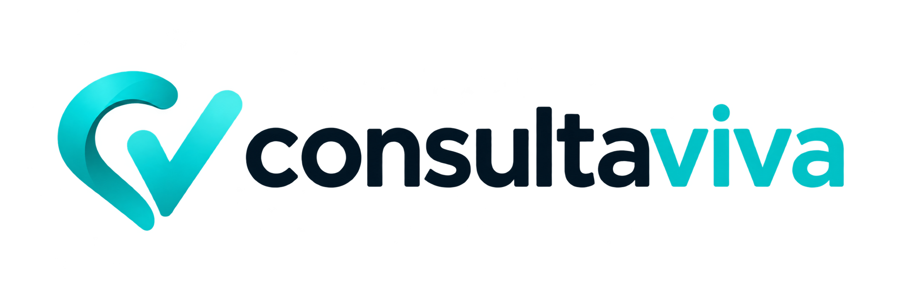
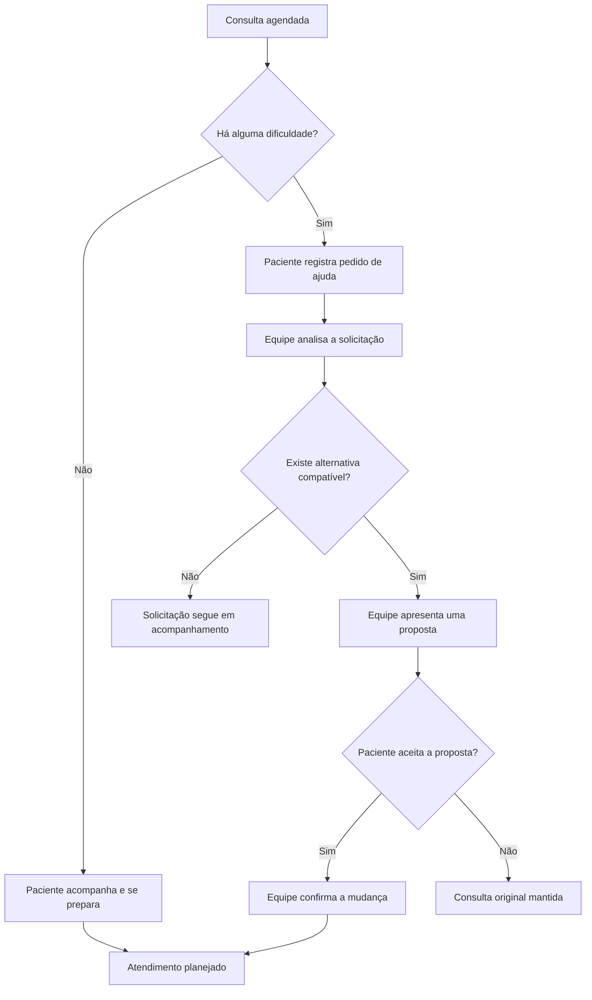
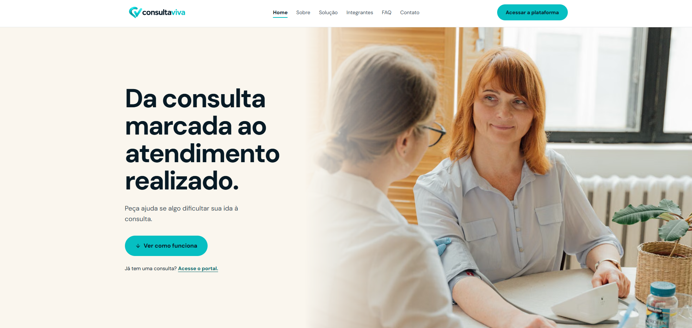
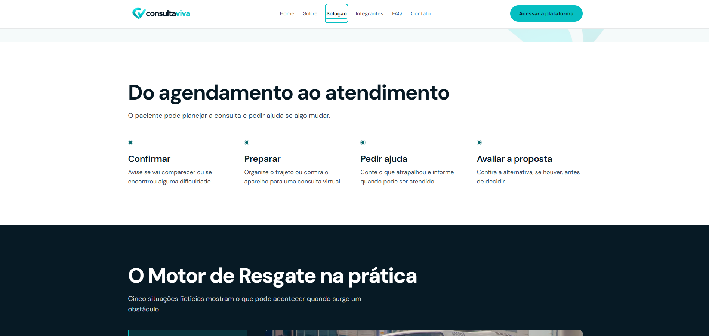
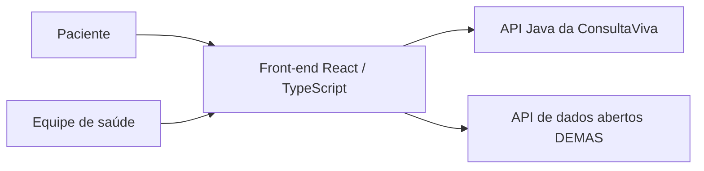

<div align="center">



# ConsultaViva

### Da consulta marcada ao atendimento realizado.

**Uma plataforma que conecta pacientes e equipes de saúde para acompanhar agendamentos, comunicar dificuldades e buscar alternativas quando a consulta corre o risco de não acontecer.**

<p>
  
  
  
</p>

<p>
  
  
  
  
</p>

[**Conhecer a solução**](#a-solução) · [**Explorar as telas**](#galeria-da-aplicação) · [**Ver funcionalidades**](#funcionalidades) · [**Executar localmente**](#como-executar) · [**Conhecer a equipe**](#equipe-do-projeto)

</div>

---

## Visão geral

Uma consulta marcada é apenas o primeiro passo. Entre o agendamento e o atendimento, o paciente pode enfrentar atrasos no transporte, mudanças de disponibilidade, dificuldades de deslocamento ou problemas técnicos em uma consulta virtual.

A **ConsultaViva** foi idealizada para reduzir a distância entre o agendamento e o comparecimento. Em um mesmo fluxo, o paciente consegue acompanhar suas consultas, sinalizar impedimentos e responder a possíveis alternativas; a equipe tem ferramentas para organizar agendas, analisar solicitações e gerenciar propostas.

| O desafio | A proposta da ConsultaViva |
| :--- | :--- |
| Um imprevisto pode impedir o comparecimento. | O paciente registra o que aconteceu e informa sua disponibilidade. |
| A equipe precisa entender cada situação. | Solicitações e agendamentos podem ser acompanhados no portal da equipe. |
| Uma alteração de horário exige comunicação. | Uma proposta pode ser apresentada para avaliação do paciente. |
| Uma consulta não deve mudar sem confirmação. | O processo preserva a decisão do paciente sobre a alternativa oferecida. |

> [!IMPORTANT]
> **Projeto acadêmico / demonstração.** A ConsultaViva utiliza dados e agendamentos fictícios no protótipo e **não consulta nem altera agendamentos reais do SUS**. As simulações demonstram a proposta; não constituem serviço oficial de saúde ou mecanismo de triagem clínica.

## A solução

O projeto combina **dois portais** — paciente e equipe — com um site institucional que explica a proposta e demonstra o **Motor de Resgate**.

### A jornada de uma consulta



*Fluxo ilustrativo da proposta. A existência de alternativas depende das condições e dos horários disponíveis no protótipo.*

### O Motor de Resgate

O **Motor de Resgate** organiza situações em que o agendamento pode não se concretizar. A demonstração institucional explora cinco cenários: **trajeto incompatível, conversão para virtual, instabilidade técnica, recuperação de vaga e resgate seguro**.

O conceito é simples: **identificar a dificuldade, avaliar uma opção e manter o paciente informado antes de confirmar qualquer mudança**. O sistema utiliza regras de agendamento para procurar alternativas; não usa IA para determinar prioridade clínica.

---

## Galeria da aplicação

As imagens a seguir foram capturadas do site ConsultaViva. Elas mostram a experiência institucional e a forma como o projeto apresenta seu funcionamento.

### 01 · Página inicial

A Home sintetiza a proposta e orienta o visitante a conhecer a plataforma ou acessar o portal.

<div align="center">
  
</div>

### 02 · Contexto e desenvolvimento da ideia

A página **Sobre** apresenta o problema e o percurso de investigação da equipe.

<table>
  <tr>
    <td width="50%" align="center" valign="top">
      <strong>Por que uma consulta marcada pode não acontecer?</strong><br/><br/>
      
    </td>
    <td width="50%" align="center" valign="top">
      <strong>Como chegamos à solução</strong><br/><br/>
      
    </td>
  </tr>
</table>

### 03 · Funcionamento e exemplos de resgate

A página **Solução** explica as etapas do atendimento e apresenta os cenários fictícios do Motor de Resgate.

<table>
  <tr>
    <td width="50%" align="center" valign="top">
      <strong>Do agendamento ao atendimento</strong><br/><br/>
      
    </td>
    <td width="50%" align="center" valign="top">
      <strong>Motor de Resgate na prática</strong><br/><br/>
      
    </td>
  </tr>
</table>

### 04 · Quem construiu o projeto

A página de integrantes reúne os cinco estudantes, suas identificações acadêmicas e seus perfis profissionais.

<div align="center">
  
</div>

### 05 · Informação e contato

As páginas de FAQ e Contato ajudam visitantes e avaliadores a entender o protótipo e localizar a equipe.

<table>
  <tr>
    <td width="50%" align="center" valign="top">
      <strong>Perguntas frequentes</strong><br/><br/>
      
    </td>
    <td width="50%" align="center" valign="top">
      <strong>Fale com a equipe</strong><br/><br/>
      
    </td>
  </tr>
</table>

> **Nota sobre Contato:** nesta versão, o formulário permite **copiar a mensagem** para conversar com a equipe pelos perfis de integrantes; ele não envia mensagens diretamente pelo site.

---

## Funcionalidades

| Área | Recursos principais | Caminhos |
| :--- | :--- | :--- |
| **Site institucional** | Home, Sobre, Solução, Integrantes, FAQ e Contato | `/`, `/sobre`, `/solucao`, `/integrantes`, `/faq`, `/contato` |
| **Autenticação** | Tela de acesso e cadastro de paciente | `/acesso`, `/cadastro` |
| **Portal do paciente** | Visão geral, consultas e detalhes, registro e acompanhamento de solicitações e propostas, ajuda | `/paciente` e subrotas |
| **Portal da equipe** | Visão geral, pacientes, unidades, horários, agendamentos, solicitações e propostas | `/equipe` e subrotas |

### Para o paciente

- Visualizar consultas e informações de agendamento.
- Comunicar uma dificuldade para comparecer ou participar de uma consulta.
- Informar condições e disponibilidade no pedido de ajuda.
- Acompanhar o andamento da solicitação e responder às propostas recebidas.

### Para a equipe

- Consultar e gerenciar cadastros de pacientes e unidades.
- Organizar horários e agendamentos da agenda demonstrativa.
- Analisar solicitações de ajuda e acompanhar propostas.
- Trabalhar com o fluxo de resgate de consultas e reaproveitamento de horários, conforme as regras do protótipo.

---

## Tecnologias utilizadas

| Tecnologia | Papel no projeto |
| :--- | :--- |
| **React 19** | Construção dos componentes e interfaces. |
| **TypeScript 7** | Tipagem dos componentes, serviços e modelos de dados. |
| **Vite 8** | Ambiente de desenvolvimento e build de produção. |
| **React Router 7** | Navegação e carregamento sob demanda das rotas. |
| **Tailwind CSS 4** | Estilização, responsividade e identidade visual. |
| **React Icons** | Biblioteca de ícones. |
| **oxlint** | Verificações estáticas de lint. |

### Arquitetura e serviços



- **Front-end:** este repositório, com as páginas públicas e os portais do paciente e da equipe.
- **API Java:** serviço independente que atende às operações do sistema, configurado por `VITE_API_URL` e hospedado no Render no ambiente de referência.
- **DEMAS / Ministério da Saúde:** API pública consultada para obter dados de estabelecimentos de saúde, com endereço configurável por `VITE_DEMAS_API_URL`.

**API Java de referência:** https://consultaviva-java.onrender.com  
**API de dados abertos:** https://apidadosabertos.saude.gov.br

> O acesso a esses serviços depende de conectividade e disponibilidade externa. A API hospedada no Render pode levar mais tempo para responder após ficar ociosa; o cliente HTTP do front-end possui limite de espera de **4 minutos** para chamadas à API Java.

---

## Como executar

### Pré-requisitos

- **Node.js** `^20.19.0` ou `>=22.12.0` (o projeto inclui `.nvmrc` para Node 22).
- **npm** disponível no terminal.
- Acesso à internet para instalar dependências e consultar as APIs.

### 1. Clonar e instalar

```bash
git clone https://github.com/EnzoNukui/consultaviva-front.git
cd consultaviva-front
npm install
```

### 2. Configurar o ambiente

Crie um arquivo `.env` na raiz a partir do exemplo fornecido no projeto:

**Windows (PowerShell)**

```powershell
Copy-Item .env.example .env
```

**macOS / Linux (terminal)**

```bash
cp .env.example .env
```

Confira os endereços no `.env`:

```dotenv
VITE_API_URL=https://consultaviva-java.onrender.com
VITE_DEMAS_API_URL=https://apidadosabertos.saude.gov.br
```

### 3. Iniciar o front-end

```bash
npm run dev
```

Acesse o endereço exibido pelo Vite no terminal (normalmente **http://localhost:5173**).

### 4. Validar o projeto

```bash
npm run lint
npm run build
```

| Script | O que faz |
| :--- | :--- |
| `npm run dev` | Inicia o servidor de desenvolvimento. |
| `npm run build` | Executa a verificação TypeScript e gera `dist/`. |
| `npm run preview` | Visualiza localmente a build de produção. |
| `npm run lint` | Executa as regras do oxlint. |

### Variáveis de ambiente

| Variável | Obrigatória? | Uso |
| :--- | :---: | :--- |
| `VITE_API_URL` | **Sim** | URL-base da API Java utilizada pelo front-end. |
| `VITE_DEMAS_API_URL` | Não | URL-base da API DEMAS; por padrão, `https://apidadosabertos.saude.gov.br`. |

---

## Organização do repositório

```text
consultaviva-front/
├── docs/
│   └── images/
│       ├── telas/            # Prints reais da aplicação
│       └── equipe/           # Miniaturas da equipe usadas no README
├── public/                   # Recursos públicos e favicon
├── src/
│   ├── assets/               # Logo, fotos originais e imagens do site
│   ├── components/           # Elementos e layouts reutilizáveis
│   ├── hooks/                # Hooks compartilhados
│   ├── routes/               # Páginas institucionais, acesso e portais
│   ├── services/             # Comunicação com as APIs
│   ├── types/                # Interfaces e tipos TypeScript
│   ├── App.tsx               # Layout institucional
│   ├── globals.css           # Tema e estilos globais
│   └── main.tsx              # Ponto de entrada da aplicação
├── .env.example              # Modelo de configuração
├── package.json              # Dependências e scripts
└── README.md                 # Documentação do projeto
```

## Limites e possíveis evoluções

A ConsultaViva apresenta uma proposta acadêmica e não deve ser confundida com um sistema oficial de atendimento médico. Alguns pontos importantes:

- **Agendamentos de demonstração:** não há vínculo com agendas reais do SUS.
- **Alterações de consulta:** alternativas são apresentadas para avaliação; não devem ser interpretadas como remarcações automáticas de consultas reais.
- **Decisões clínicas:** o sistema não usa IA para triagem ou definição da prioridade de atendimento.
- **Google Agenda:** a integração com calendário pessoal é uma proposta de evolução, não uma funcionalidade garantida na versão atual.
- **Contato:** o formulário auxilia a compor e copiar a mensagem; não a envia diretamente.

Entre as possibilidades de evolução estão ampliar testes automatizados, revisar a experiência em diferentes dispositivos e estudar integrações adicionais quando houver os requisitos técnicos e institucionais necessários.

---

## Equipe do projeto

Desenvolvido por estudantes da **FIAP** para a **Global Solution 2026/2**.

<table>
  <tr>
    <td align="center" width="33%" valign="top">
      <br/>
      <strong>Arthur Carvalho Brito Martins</strong><br/>
      <sub>RM 572325 · 1TDSPO</sub><br/>
      <a href="https://github.com/arthurmartinss">GitHub</a> · <a href="https://www.linkedin.com/in/arthur-martinss/">LinkedIn</a>
    </td>
    <td align="center" width="33%" valign="top">
      <br/>
      <strong>Diego Soares Trujillo</strong><br/>
      <sub>RM 570147 · 1TDSPH</sub><br/>
      <a href="https://github.com/diegotrujillo011">GitHub</a> · <a href="https://www.linkedin.com/in/diego-trujillo-3441b9380/">LinkedIn</a>
    </td>
    <td align="center" width="33%" valign="top">
      <br/>
      <strong>Eduardo Damasio Guelere</strong><br/>
      <sub>RM 569960 · 1TDSPH</sub><br/>
      <a href="https://github.com/Eduardoguelere">GitHub</a> · <a href="https://www.linkedin.com/in/eduardo-guelere-0902753b8/">LinkedIn</a>
    </td>
  </tr>
  <tr>
    <td align="center" valign="top">
      <br/>
      <strong>Enzo Nukui da Silva</strong><br/>
      <sub>RM 569770 · 1TDSPH</sub><br/>
      <a href="https://github.com/EnzoNukui">GitHub</a> · <a href="https://www.linkedin.com/in/enzo-nukui/">LinkedIn</a>
    </td>
    <td align="center" valign="top">
      <br/>
      <strong>Leticia Cardoso de Almeida</strong><br/>
      <sub>RM 569415 · 1TDSPH</sub><br/>
      <a href="https://github.com/lehalmeidafc0">GitHub</a> · <a href="https://www.linkedin.com/in/let%C3%ADcia-almeida-70b851294/">LinkedIn</a>
    </td>
    <td align="center" valign="middle">
      <sub>Feito em equipe para a<br/>Global Solution 2026/2 · FIAP</sub>
    </td>
  </tr>
</table>

---

<div align="center">
  
  <p><strong>ConsultaViva</strong><br/>Da consulta marcada ao atendimento realizado.</p>
  <sub>Repositório do front-end · Global Solution 2026/2 · FIAP</sub>
</div>
