<div align="center">


<h1>ConsultaViva</h1>

<h3>Da consulta marcada ao atendimento realizado.</h3>

<p>
  Uma plataforma para aproximar pacientes e equipes de saúde, acompanhar agendamentos<br />
  e encontrar alternativas quando um imprevisto coloca uma consulta em risco.
</p>

<p>
  
  
  
</p>

<p>
  
  
  
  
</p>

<p>
  <a href="https://consultaviva-five.vercel.app/">
    
  </a>
  <a href="https://www.youtube.com/watch?v=t9vJyq6__-E">
    
  </a>
  <a href="https://github.com/EnzoNukui/consultaviva-front">
    
  </a>
</p>

**[Conhecer a solução](#a-solução)** · **[Explorar as telas](#galeria-da-aplicação)** · **[Como executar](#como-executar-localmente)** · **[Conhecer a equipe](#integrantes)**

</div>

---

## Links do projeto

| Recurso | Acesso | Descrição |
| :--- | :--- | :--- |
| **Aplicação publicada** | [ConsultaViva na Vercel](https://consultaviva-five.vercel.app/) | Navegue pelo site institucional e acesse os portais. |
| **Repositório** | [Front-end no GitHub](https://github.com/EnzoNukui/consultaviva-front) | Código-fonte e histórico do projeto. |
| **Vídeo de apresentação** | [Assistir no YouTube](https://www.youtube.com/watch?v=t9vJyq6__-E) | Apresentação em vídeo da ConsultaViva. |
| **Servidor Java** | [API no Render](https://consultaviva-java.onrender.com/) | Back-end utilizado pelo front-end; a raiz da API não é necessariamente uma página navegável. |

> **Atenção:** a API Java é um serviço separado e pode demorar para responder após períodos de inatividade na hospedagem.

## Visão geral

Uma consulta pode estar marcada e, ainda assim, não acontecer. Dificuldades de transporte, incompatibilidade de horários ou problemas técnicos podem impedir o comparecimento do paciente. Enquanto isso, a equipe precisa compreender o obstáculo, verificar alternativas e manter as informações organizadas.

A **ConsultaViva** reúne essas etapas em dois ambientes conectados:

- **Portal do paciente:** visualizar consultas, comunicar dificuldades, registrar solicitações de ajuda e acompanhar propostas.
- **Portal da equipe:** gerenciar pacientes, unidades, horários e agendamentos, analisar solicitações e acompanhar o resgate de consultas.

| Situação | Como a ConsultaViva contribui |
| :--- | :--- |
| Imprevisto antes da consulta | O paciente registra o problema e informa sua disponibilidade. |
| Dificuldade para reorganizar a agenda | A equipe consulta solicitações e busca horários compatíveis. |
| Necessidade de apresentar uma alternativa | A equipe disponibiliza uma proposta de atendimento. |
| Decisão sobre novo horário ou modalidade | O paciente pode analisar a proposta antes da confirmação da mudança. |

> [!IMPORTANT]
> **Protótipo acadêmico:** a ConsultaViva trabalha com informações e agendamentos fictícios. Não acessa nem altera agendamentos reais do SUS e não realiza triagem clínica ou definição de prioridade médica por inteligência artificial.

## A solução

### Da dificuldade à alternativa

O **Motor de Resgate** representa o processo de identificação de obstáculos, análise de solicitações e apresentação de alternativas. A proposta é oferecer mais clareza ao paciente e ferramentas para a equipe tentar evitar uma consulta perdida.

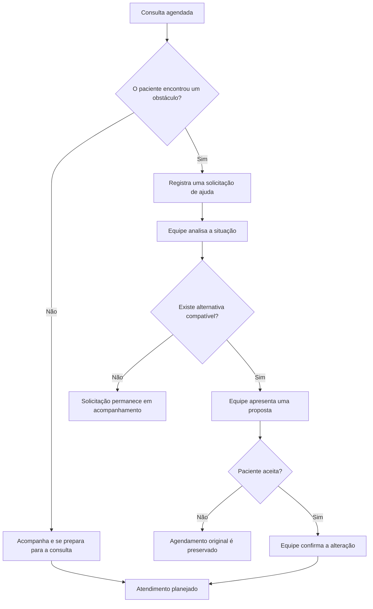

*Fluxo ilustrativo. A disponibilidade de alternativas depende das regras e dos horários cadastrados no protótipo.*

A página **Solução** demonstra cinco situações fictícias: **trajeto incompatível**, **conversão para virtual**, **instabilidade técnica**, **recuperação de vaga** e **resgate seguro**. Nenhuma alteração ocorre automaticamente sem a confirmação prevista no fluxo.

## Funcionalidades

| Ambiente | Funcionalidades principais |
| :--- | :--- |
| **Institucional** | Home, Sobre, Solução, Integrantes, FAQ e Contato. |
| **Acesso** | Login e cadastro de paciente. |
| **Paciente** | Visão geral, consultas, agendamento, solicitações de ajuda, detalhes e propostas recebidas. |
| **Equipe** | Visão geral, cadastros, horários, agendamentos, análise de solicitações e propostas. |

**Rotas principais:**

```text
/                  /sobre              /solucao
/integrantes       /faq                /contato
/acesso            /cadastro           /paciente
/paciente/consultas                    /paciente/solicitacoes
/paciente/ajuda                        /equipe
/equipe/pacientes                      /equipe/unidades
/equipe/horarios                       /equipe/agendamentos
/equipe/solicitacoes                   /equipe/propostas
```

## Galeria da aplicação

As capturas abaixo são **imagens reais incluídas neste repositório**, mostrando o site institucional e os dois portais.

### 01 — Página inicial

A Home apresenta a missão da ConsultaViva e direciona o visitante para conhecer a solução ou acessar a plataforma.

<p align="center">
  
</p>

### 02 — Sobre e evolução da ideia

A origem do problema e o caminho que levou à proposta.

<table>
  <tr>
    <th align="center">O problema</th>
    <th align="center">Como chegamos à solução</th>
  </tr>
  <tr>
    <td width="50%">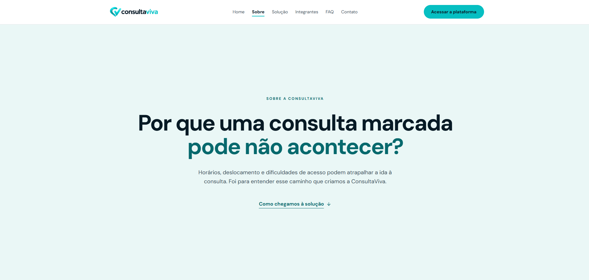</td>
    <td width="50%">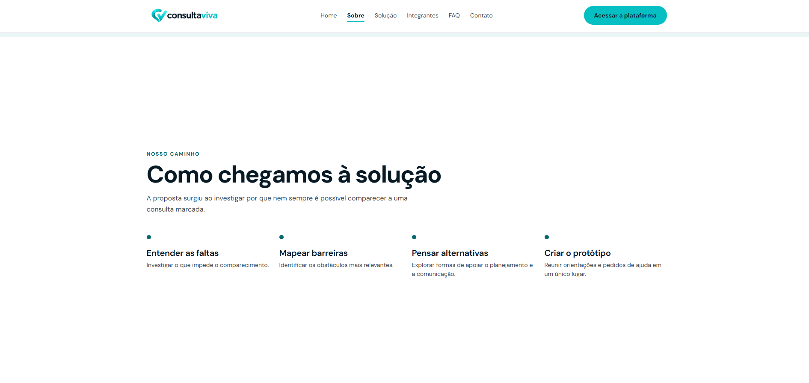</td>
  </tr>
</table>

### 03 — Apresentação da solução

O fluxo do agendamento até o atendimento e a demonstração do Motor de Resgate.

<table>
  <tr>
    <th align="center">Jornada do atendimento</th>
    <th align="center">Motor de Resgate em ação</th>
  </tr>
  <tr>
    <td width="50%"></td>
    <td width="50%">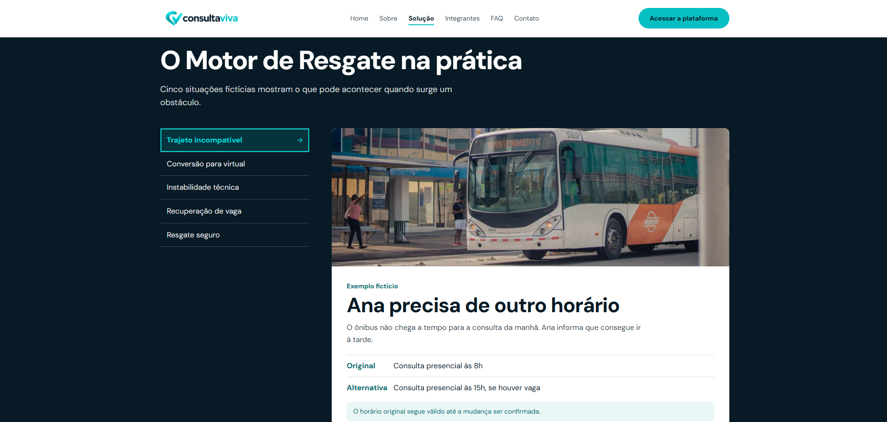</td>
  </tr>
</table>

### 04 — Integrantes, FAQ e contato

A apresentação dos desenvolvedores, as perguntas frequentes e o formulário de contato.

<p align="center">
  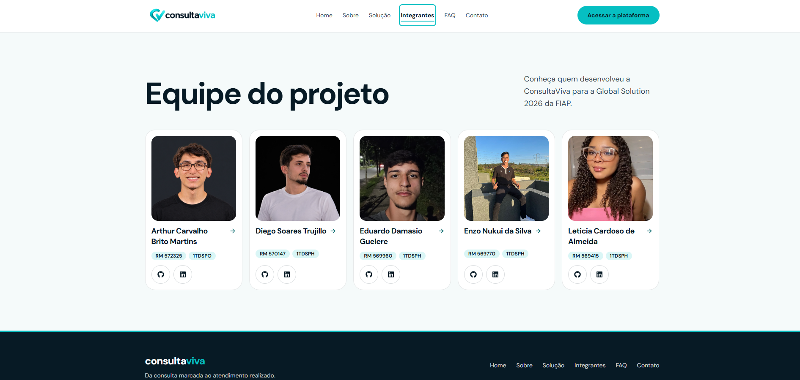
</p>

<table>
  <tr>
    <th align="center">Perguntas frequentes</th>
    <th align="center">Contato</th>
  </tr>
  <tr>
    <td width="50%">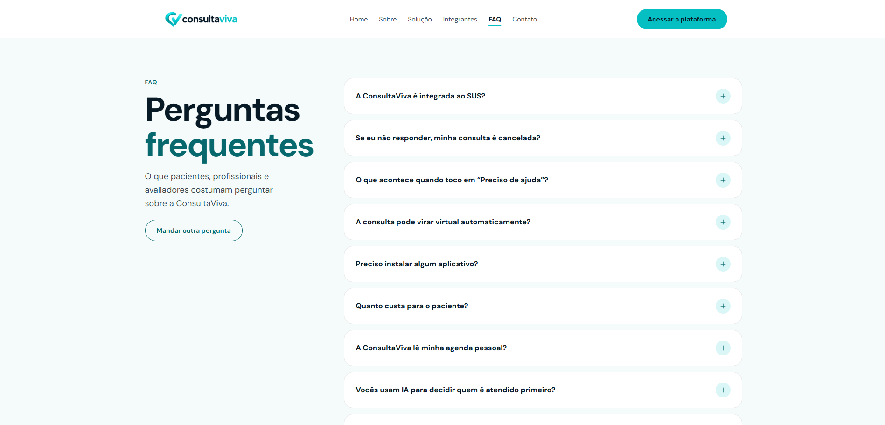</td>
    <td width="50%">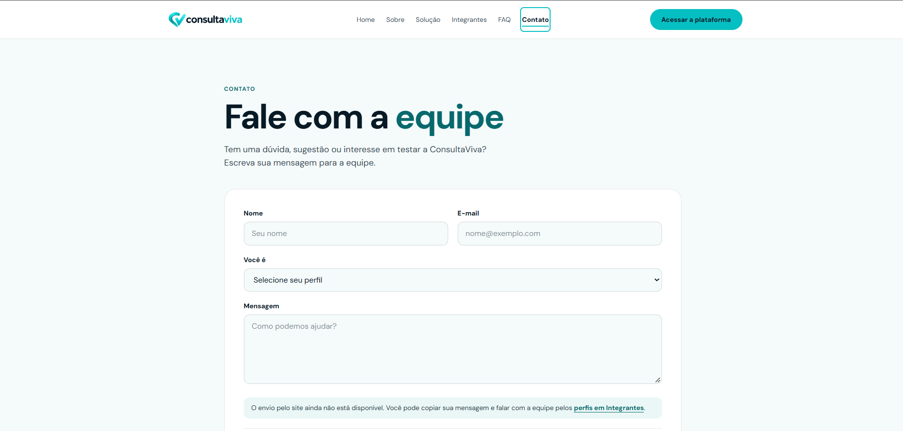</td>
  </tr>
</table>

> **Observação:** na versão atual, o formulário de contato **copia a mensagem**, mas ainda não a envia diretamente pelo site.

### 05 — Portal do paciente

O paciente consegue acompanhar seus atendimentos, agendar uma consulta, registrar um imprevisto e consultar o andamento de solicitações.

<table>
  <tr>
    <th align="center">Início do portal</th>
    <th align="center">Minhas consultas</th>
  </tr>
  <tr>
    <td width="50%">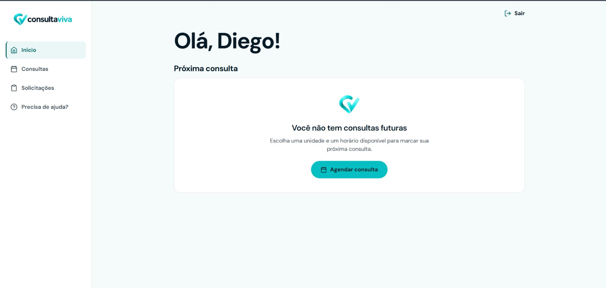</td>
    <td width="50%">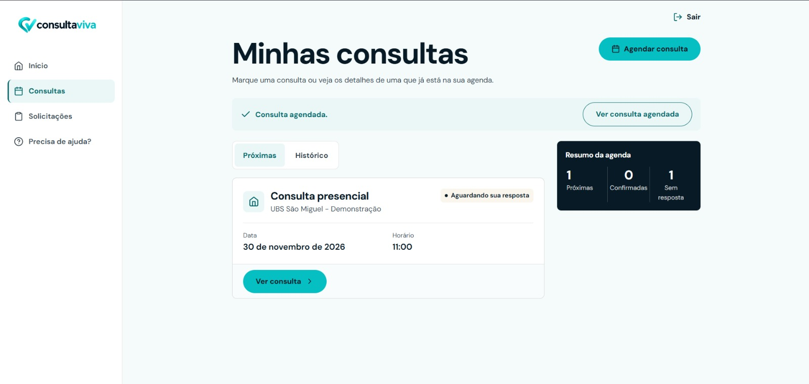</td>
  </tr>
  <tr>
    <th align="center">Agendar consulta</th>
    <th align="center">Registrar solicitação</th>
  </tr>
  <tr>
    <td>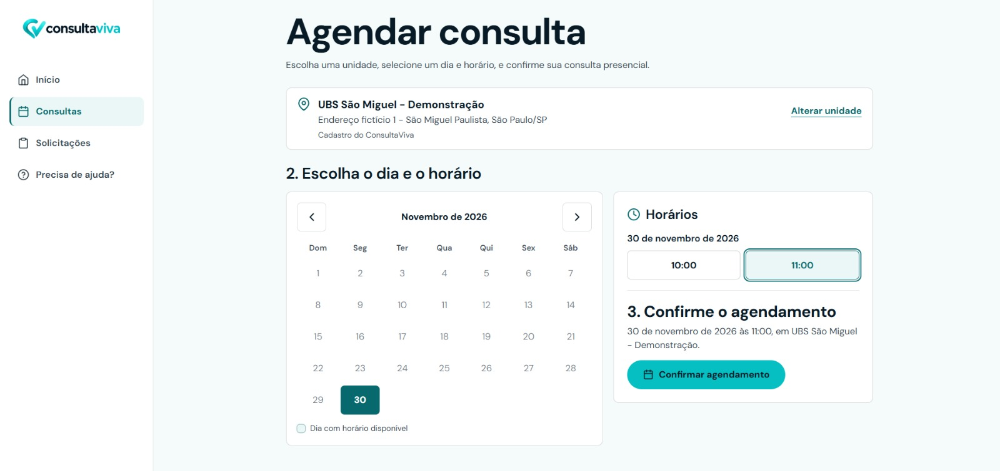</td>
    <td>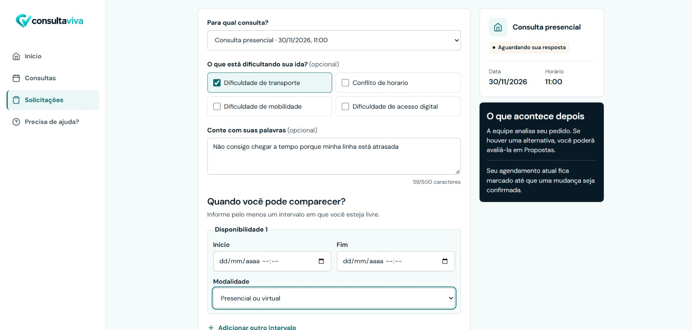</td>
  </tr>
  <tr>
    <th align="center">Detalhes da solicitação</th>
    <th align="center">Precisa de ajuda?</th>
  </tr>
  <tr>
    <td>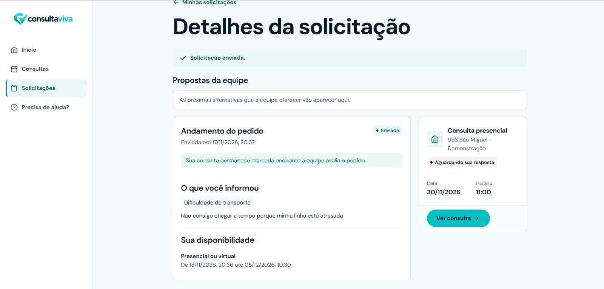</td>
    <td>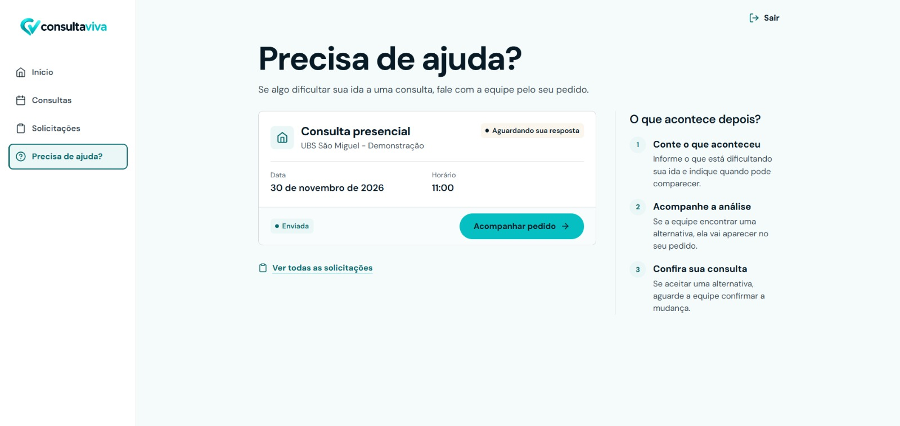</td>
  </tr>
</table>

### 06 — Portal da equipe

A equipe visualiza informações da agenda, acompanha solicitações, administra horários e trabalha com o Motor de Resgate.

<table>
  <tr>
    <th align="center">Visão geral</th>
    <th align="center">Agendamentos</th>
  </tr>
  <tr>
    <td width="50%">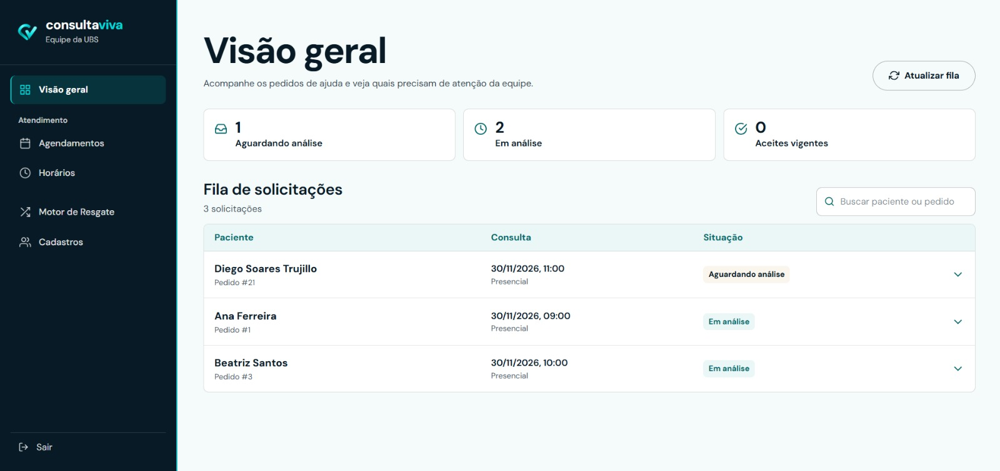</td>
    <td width="50%">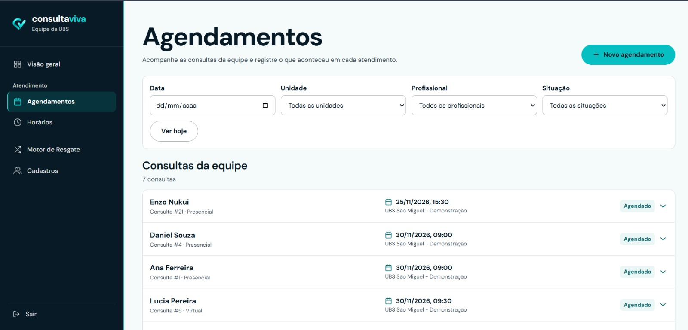</td>
  </tr>
  <tr>
    <th align="center">Horários disponíveis</th>
    <th align="center">Cadastros</th>
  </tr>
  <tr>
    <td>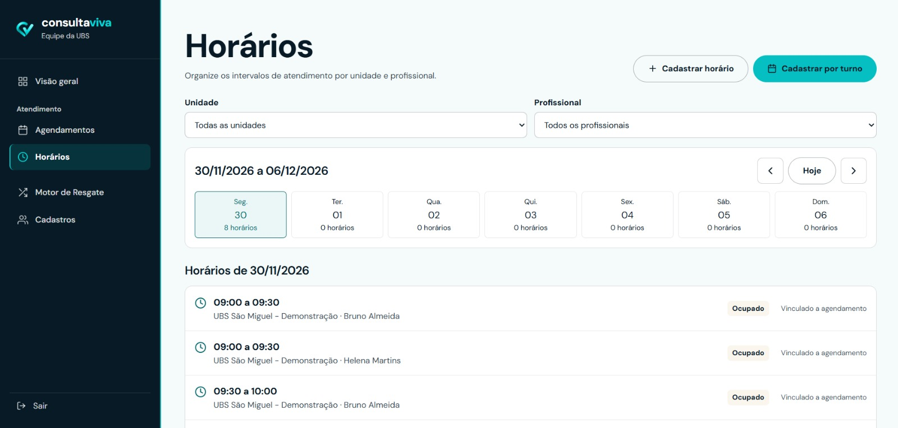</td>
    <td>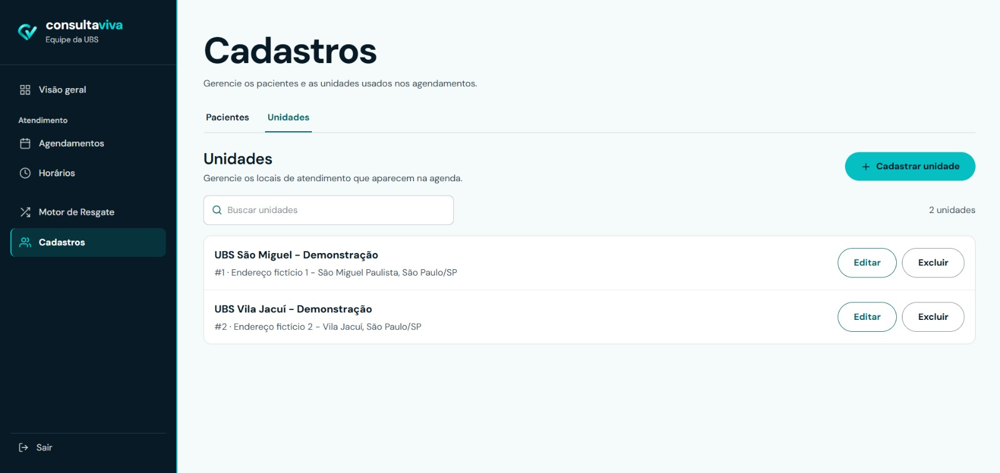</td>
  </tr>
</table>

**Motor de Resgate — análise de solicitações**

<p align="center">
  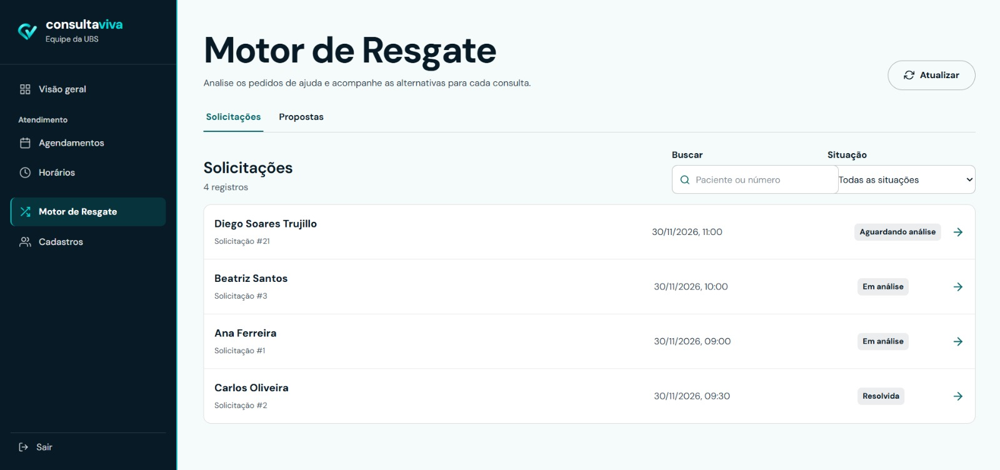
</p>

---

## Tecnologias e arquitetura

| Tecnologia | Utilização |
| :--- | :--- |
| **React 19** | Construção das páginas e dos componentes. |
| **TypeScript 7** | Tipagem e organização do código. |
| **Vite 8** | Servidor de desenvolvimento e build de produção. |
| **React Router 7** | Navegação e carregamento sob demanda das rotas. |
| **Tailwind CSS 4** | Estilos, componentes responsivos e identidade visual. |
| **React Icons** | Ícones de interface. |
| **oxlint** | Análise estática do código. |

### Visão simplificada da arquitetura

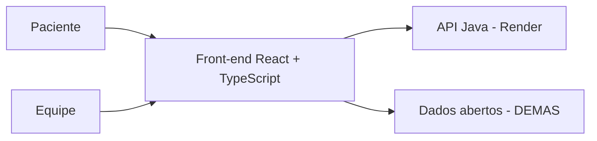

O front-end deste repositório consome uma **API Java separada**, configurada por `VITE_API_URL`, e utiliza a **API de dados abertos do Ministério da Saúde (DEMAS)** para consultar informações sobre estabelecimentos de saúde. Os dados de demonstração de consultas não correspondem a agendas reais do SUS.

- **API Java:** https://consultaviva-java.onrender.com/
- **API pública DEMAS:** https://apidadosabertos.saude.gov.br/

O cliente HTTP aceita um limite de espera de **4 minutos para a API Java** e de **30 segundos para consultas ao DEMAS**. Uma primeira requisição ao serviço hospedado no Render pode demorar quando ele esteve inativo.

## Como executar localmente

### Pré-requisitos

- Node.js `^20.19.0` ou `>=22.12.0` (o repositório contém `.nvmrc` com Node 22).
- npm e acesso à internet para instalação de dependências.

### 1. Clonar o repositório

```bash
git clone https://github.com/EnzoNukui/consultaviva-front.git
cd consultaviva-front
npm install
```

### 2. Configurar o arquivo `.env`

No **Windows (PowerShell)**:

```powershell
Copy-Item .env.example .env
```

No **macOS ou Linux**:

```bash
cp .env.example .env
```

O modelo de configuração contém:

```dotenv
VITE_API_URL=https://consultaviva-java.onrender.com
VITE_DEMAS_API_URL=https://apidadosabertos.saude.gov.br
```

| Variável | Obrigatória? | Finalidade |
| :--- | :---: | :--- |
| `VITE_API_URL` | Sim | Endereço-base da API Java. |
| `VITE_DEMAS_API_URL` | Não | API DEMAS; se omitida, o código usa `https://apidadosabertos.saude.gov.br`. |

### 3. Iniciar a aplicação

```bash
npm run dev
```

Abra o endereço indicado pelo Vite (normalmente **http://localhost:5173**).

### 4. Conferir a qualidade e gerar a build

```bash
npm run lint
npm run build
```

| Comando | Finalidade |
| :--- | :--- |
| `npm run dev` | Iniciar o servidor de desenvolvimento. |
| `npm run build` | Verificar os tipos e gerar a versão de produção em `dist/`. |
| `npm run preview` | Pré-visualizar a build de produção. |
| `npm run lint` | Executar o oxlint. |

## Organização do repositório

```text
consultaviva-front/
├── docs/
│   └── images/
│       ├── telas/          # 8 capturas das páginas institucionais
│       ├── paciente/       # 6 capturas do portal do paciente
│       └── equipe/         # 5 capturas do portal da equipe
├── public/                 # Arquivos públicos, incluindo o favicon
├── src/
│   ├── assets/
│   │   ├── integrantes/    # Fotografias dos integrantes
│   │   ├── marca/          # Identidade visual da ConsultaViva
│   │   └── sobre/          # Imagens da página Sobre
│   ├── components/         # Componentes reutilizáveis
│   ├── hooks/              # Hooks personalizados
│   ├── routes/             # Páginas institucionais, acesso e portais
│   ├── services/           # Integração com API Java e DEMAS
│   ├── types/              # Interfaces e tipos TypeScript
│   ├── App.tsx
│   ├── globals.css
│   └── main.tsx
├── .env.example
├── package.json
└── README.md
```

## Integrantes

Equipe da **FIAP — Global Solution 2026/2**.

<table>
  <tr>
    <td align="center" valign="top" width="33%">
      <br />
      <strong>Arthur Carvalho Brito Martins</strong><br />
      <sub>RM 572325 · 1TDSPO</sub><br />
      <a href="https://github.com/arthurmartinss">GitHub</a> · <a href="https://www.linkedin.com/in/arthur-martinss/">LinkedIn</a>
    </td>
    <td align="center" valign="top" width="33%">
      <br />
      <strong>Diego Soares Trujillo</strong><br />
      <sub>RM 570147 · 1TDSPH</sub><br />
      <a href="https://github.com/diegotrujillo011">GitHub</a> · <a href="https://www.linkedin.com/in/diego-trujillo-3441b9380/">LinkedIn</a>
    </td>
    <td align="center" valign="top" width="33%">
      <br />
      <strong>Eduardo Damasio Guelere</strong><br />
      <sub>RM 569960 · 1TDSPH</sub><br />
      <a href="https://github.com/Eduardoguelere">GitHub</a> · <a href="https://www.linkedin.com/in/eduardo-guelere-0902753b8/">LinkedIn</a>
    </td>
  </tr>
  <tr>
    <td align="center" valign="top">
      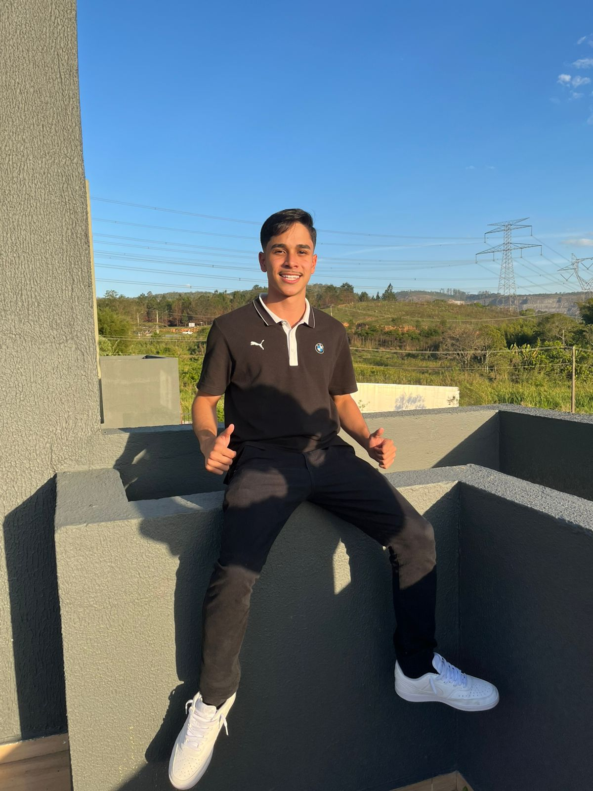<br />
      <strong>Enzo Nukui da Silva</strong><br />
      <sub>RM 569770 · 1TDSPH</sub><br />
      <a href="https://github.com/EnzoNukui">GitHub</a> · <a href="https://www.linkedin.com/in/enzo-nukui/">LinkedIn</a>
    </td>
    <td align="center" valign="top">
      <br />
      <strong>Leticia Cardoso de Almeida</strong><br />
      <sub>RM 569415 · 1TDSPH</sub><br />
      <a href="https://github.com/lehalmeidafc0">GitHub</a> · <a href="https://www.linkedin.com/in/let%C3%ADcia-almeida-70b851294/">LinkedIn</a>
    </td>
    <td align="center" valign="middle">
      <strong>ConsultaViva</strong><br />
      <sub>Global Solution 2026/2 · FIAP</sub>
    </td>
  </tr>
</table>

## Limitações e próximas etapas

- O projeto é um **protótipo acadêmico com informações de demonstração**, não uma solução oficial de agendamento do SUS.
- O **Motor de Resgate** usa regras de agendamento e não realiza triagem clínica por IA.
- A integração com **Google Agenda** é uma possibilidade futura, não um recurso ativo.
- O formulário de **Contato** copia a mensagem para uso fora da plataforma, sem enviá-la diretamente.
- Melhorias futuras podem incluir testes automatizados, acessibilidade, refinamento mobile e novas integrações.

---

<div align="center">
  
  <p><strong>ConsultaViva</strong><br />Da consulta marcada ao atendimento realizado.</p>
  <sub>Global Solution 2026/2 · FIAP · Front-end em React + TypeScript</sub>
</div>
